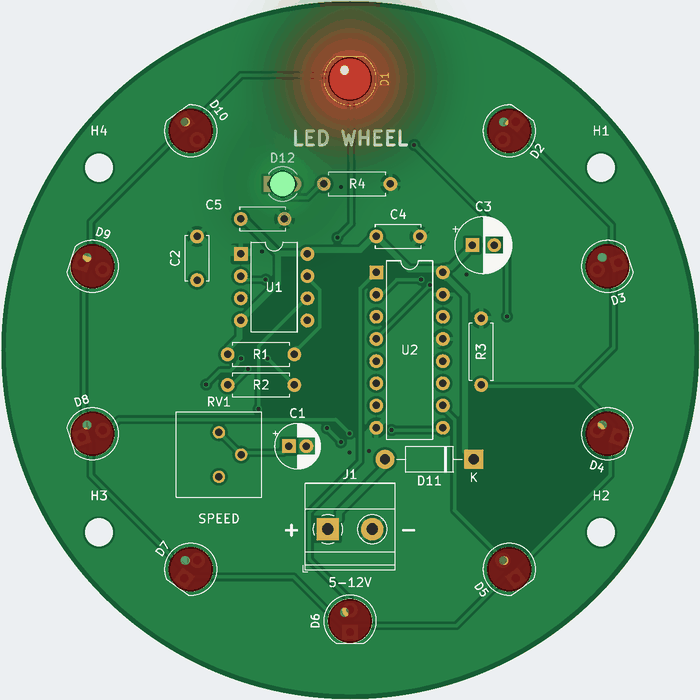
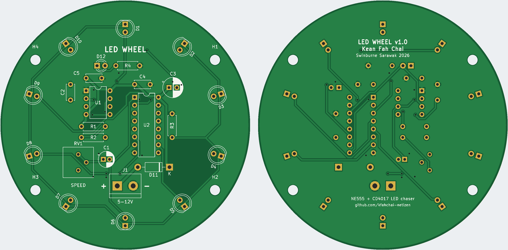
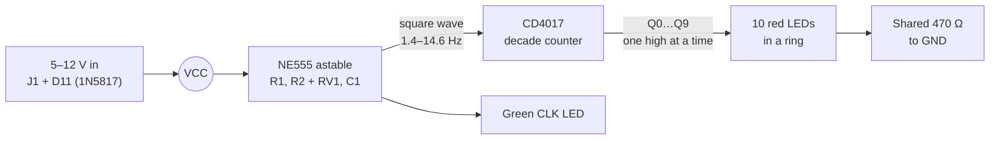
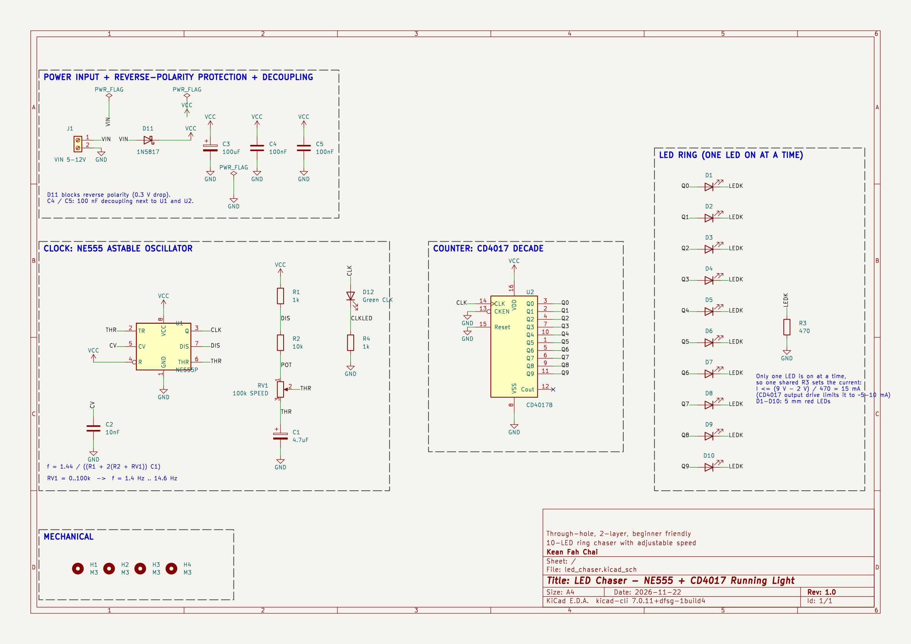

<div align="center">

# 🎡 LED Wheel: NE555 + CD4017 Running-Light PCB

**A round, 80 mm, 2-layer through-hole PCB in KiCad: a 555 timer clocks a CD4017 decade counter that chases a ring of 10 LEDs, with a knob to set the speed.**




</div>

---

## 📌 Overview

| | |
|---|---|
| **What it does** | One LED at a time lights up and the light runs round the ring. A green LED blinks with every clock pulse. |
| **Circuit** | NE555 astable oscillator (clock) → CD4017 decade counter (Q0…Q9) → 10 LEDs |
| **Speed** | Trimmer RV1 sets about **1.4 Hz to 14.6 Hz** (steps per second) |
| **Power** | 5–12 V DC (a 9 V battery is ideal) through a screw terminal, with reverse-polarity protection |
| **Board** | Ø 80 mm round, 2 layers, all through-hole, GND pour on both sides, 4 × M3 mounting holes |
| **Status** | Rev 1.0: design complete, ERC netlist verified, **DRC clean**, Gerbers ready. *Not yet fabricated.* |

## 🖼️ Board

<p align="center">
  
  <br><sub>Front (left) and back (right). Renders are made from the actual copper, solder-mask and silkscreen layers.</sub>
</p>

## 🧠 How it works



### 1. Clock: NE555 astable

C1 charges through R1 + R2 + RV1 and discharges through R2 + RV1 into pin 7. That makes a square wave at

$$f = \frac{1.44}{(R_1 + 2(R_2 + R_{V1}))\,C_1}$$

| RV1 | Frequency | Feel |
|---|---|---|
| 0 Ω | 1.44 / ((1 k + 2·10 k) · 4.7 µF) ≈ **14.6 Hz** | fast spin |
| 50 kΩ | ≈ 2.5 Hz | relaxed |
| 100 kΩ | 1.44 / (221 k · 4.7 µF) ≈ **1.4 Hz** | slow step |

R2 (10 kΩ) sets a minimum resistance, so turning RV1 to zero can't short pin 7 to the timing capacitor. C2 (10 nF) on CV filters noise on the 555's internal comparator reference.

### 2. Counter: CD4017 decade counter

Each rising clock edge moves the single high output along: Q0 → Q1 → … → Q9 → Q0. `RESET` and `CLOCK ENABLE` are tied low, so it counts freely. Carry-out (pin 12) is unused and marked *no-connect* in the schematic.

### 3. LED ring

Each output drives one LED's **anode**. All **cathodes** share **one 470 Ω resistor** to GND. Only one output is ever high, so one resistor is enough: I ≤ (9 V − 2 V) / 470 Ω ≈ 15 mA. In practice the CD4017's output drive limits it to about 5–10 mA. On the PCB the cathode net is a ring track around the outside, and the 10 output tracks fan in from the counter.

### 4. Power and protection

- **D11 (1N5817 Schottky)** in series blocks reverse polarity and drops only about 0.3 V.
- **C3 (100 µF)** is the bulk reservoir; **C4 / C5 (100 nF)** decouple each IC, placed next to its supply pin.

## 📐 Schematic

<p align="center"></p>

Full-resolution PDF: [`docs/led_chaser_schematic.pdf`](docs/led_chaser_schematic.pdf)

## 🛠️ PCB design decisions

| Decision | Why |
|---|---|
| **Round 80 mm board, LEDs on a 32 mm radius** | Looks like a wheel; 36° spacing makes the chase smooth |
| **LEDs placed radially, anode inside and cathode outside** | Output tracks come in from the centre and the cathode ring runs round the outside, so no crossings |
| **Net classes:** signals 0.4 mm, power (VIN/VCC/GND) 0.7 mm, 0.3 mm clearance | Easy to fabricate and solder, and comfortably above typical fab limits |
| **GND pour on both layers + thermal reliefs** | Low-impedance return, less copper to etch, pads stay easy to solder |
| **All through-hole parts** | Hand-solderable for a first build or workshop kit |
| **Polarity marks (+/−), "SPEED" and name on the silkscreen** | Fewer assembly mistakes; looks finished |

**Verification**

- The schematic netlist exported by `kicad-cli` is compared with the design description: **all 20 nets match**.
- Every PCB footprint is linked to its schematic symbol (29/29), so *Update PCB from Schematic* works.
- KiCad DRC shows **0 clearance errors and 0 unconnected pads**.

## ⚙️ Design as code

The whole design is generated from one Python description (`tools/design.py`): parts, footprints and every connection. That means the schematic and PCB can never drift apart.

| Script | What it does |
|---|---|
| `tools/gen_sch.py` | Writes the KiCad schematic: places library symbols, net labels, power flags, block frames and notes |
| `tools/gen_pcb.py` | Places footprints (LED ring maths), assigns nets, draws the round outline and silkscreen |
| `tools/astar_router.py` | **A small custom 2-layer autorouter written for this board:** A* search on a 0.2 mm grid, 45° moves, via and bend penalties, obstacles inflated by clearance + half track width, rip-up and retry |
| `tools/route_pcb.py` | Runs the router, adds the GND pours, fills zones and runs KiCad's DRC |
| `tools/render_board.py` | Builds the photo-style renders and the chase animation from the real layer exports |
| `build.sh` | Rebuilds everything: schematic → PCB → routing → Gerbers → docs |

```bash
pip install shapely numpy pillow cairosvg
./build.sh
```

## 🏭 Get it made

1. Upload [`fabrication/led_chaser_gerbers_jlcpcb.zip`](fabrication/led_chaser_gerbers_jlcpcb.zip) to any PCB fab (JLCPCB, PCBWay and others). The defaults are fine: 2 layers, 1.6 mm, HASL or ENIG.
2. Buy the parts in [`fabrication/bom.csv`](fabrication/bom.csv). They're all common through-hole parts.
3. Solder from lowest to tallest: resistors → diode → IC sockets → ceramic caps → LEDs → trimmer → electrolytics → terminal.
4. Watch polarity on **D1–D12** (flat side / square pad = cathode), **C1/C3** (+ marked), **D11** (band = K) and the IC notches.

### Bill of materials

| Qty | Ref | Value | Part |
|---|---|---|---|
| 1 | U1 | NE555P | 555 timer, DIP-8 |
| 1 | U2 | CD4017B | Decade counter, DIP-16 |
| 10 | D1–D10 | Red | 5 mm LED |
| 1 | D12 | Green | 3 mm LED (clock indicator) |
| 1 | D11 | 1N5817 | Schottky diode, DO-41 |
| 2 | R1, R4 | 1 kΩ | ¼ W axial |
| 1 | R2 | 10 kΩ | ¼ W axial |
| 1 | R3 | 470 Ω | ¼ W axial |
| 1 | RV1 | 100 kΩ | Bourns 3386P trimmer |
| 1 | C1 | 4.7 µF | Electrolytic, 5 mm |
| 1 | C3 | 100 µF | Electrolytic, 6.3 mm |
| 1 | C2 | 10 nF | Ceramic disc |
| 2 | C4, C5 | 100 nF | Ceramic disc |
| 1 | J1 | 2-pin | 5.08 mm screw terminal |

## 📁 Project structure

```
├── kicad/                  # KiCad project: .kicad_pro, .kicad_sch, .kicad_pcb (opens in KiCad 7–10)
├── fabrication/
│   ├── gerbers/            # Gerber + Excellon drill files
│   ├── led_chaser_gerbers_jlcpcb.zip
│   └── bom.csv
├── docs/                   # Schematic PDF/SVG, PCB PDF, images
├── tools/                  # Design-as-code generators, A* router, renderer
└── build.sh                # One-command rebuild
```

## 🚀 Ideas for Rev 2

- Replace the 555 with a microcontroller, or an **FPGA / CPLD**, to add patterns such as bounce, fill and random.
- Use **WS2812** addressable LEDs and a USB-C power input.
- Cascade two CD4017s with the carry-out pin for a 20-LED ring.
- Switch to SMD parts and get it assembled at the fab.

## 🔑 Key concepts

`555 astable timing` · `CMOS decade counter` · `schematic capture` · `PCB layout` · `net classes and design rules` · `ground pours and thermal reliefs` · `DRC / ERC` · `Gerber / Excellon fabrication output` · `A* path-finding` · `design automation with the KiCad Python API`

---

<div align="center">
<sub>Made by <b>Kean Fah Chai</b> · Swinburne University of Technology Sarawak</sub>
</div>
